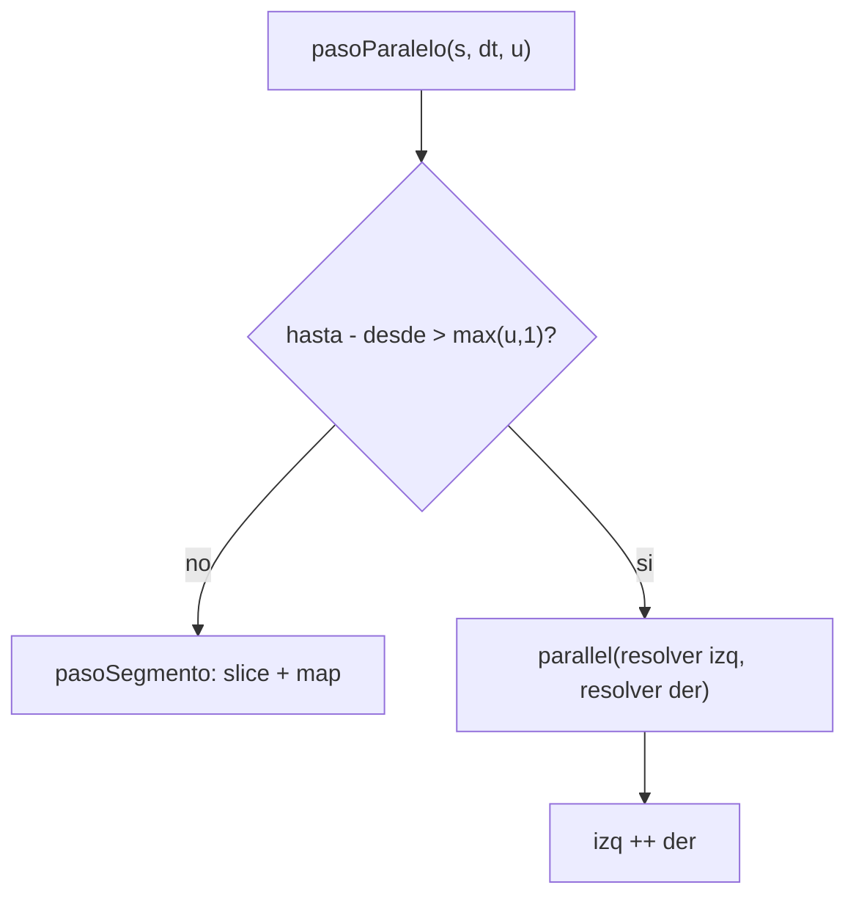

# Informe de paralelización

Este documento describe la estrategia de reparto del paso de la simulación, los
tiempos medidos al ejecutarla y la lectura de esos números. La medición la hace
`App.scala` con ScalaMeter; el protocolo exacto con que se tomaron los tiempos se
documenta en la sección 0.1, porque el `Warmer.Default` de la versión entregada no
terminaba en el hardware disponible.

## 0. El equipo y el protocolo de medición

Las medidas se tomaron en un **Intel Core i3-1005G1 a 1,20 GHz, con 2 núcleos
físicos y 4 hilos lógicos** (Windows 10, 7,8 GB de RAM). `App.scala` confirma ese
dato con `Runtime.getRuntime.availableProcessors`, que reporta 4.

`App.scala` se entrega **sin modificar**, tal como viene en el repositorio. El
problema es que `medir`, la función del enunciado, usa `Warmer.Default`, que
repite el bloque hasta 50 veces y corta cuando la desviación de la muestra baja
del umbral. Con arreglos de un millón de partículas ese criterio no se cumplía en
un tiempo razonable en este equipo y la corrida se colgaba. Para poder medir se
usó **por fuera de `App.scala`** un protocolo de medición equivalente, que se
describe abajo completo. Lo que se cronometra (`pasoSecuencial` y
`pasoParalelo`) es exactamente el mismo código en las dos columnas: el protocolo
solo cambia **cuándo y cómo se mide**, no **qué se mide**.

### 0.1 El código del protocolo

```Scala
import org.scalameter._

/** `Warmer.Default` pero con un techo de calentamientos apto para este equipo. */
class WarmerCorto(corridas: Int) extends Warmer {
  private val base = Warmer.Default()

  def name: String = s"WarmerCorto($corridas)"

  def warming(ctx: Context, setup: () => Any, teardown: () => Any): Foreach[Int] =
    base.warming(ctx + (Key.exec.requireGC -> false), setup, teardown)
}

/**
 * Mide con ScalaMeter y devuelve la mediana en milisegundos. El calentamiento
 * es fijo (12 corridas) en vez del `Warmer.Default`, que corta solo cuando
 * detecta estabilidad y en este equipo no llega a cortar en un tiempo razonable.
 */
def medirCorto[A](cuerpo: => A): Double = {
  val base = org.scalameter
    .withWarmer(new WarmerCorto(12))
    .withMeasurer(org.scalameter.MeasureBuilder.timeMeasurer)
    .config(Key.verbose := false, Key.exec.benchRuns := 5, Key.exec.requireGC := false,
      Key.exec.minWarmupRuns := 12, Key.exec.maxWarmupRuns := 12)
  (base measure { cuerpo }).value
}
```

Con ese `medirCorto` se reemplazaron las dos llamadas `medir(1)(...)` dentro de
`medirFila`, y el número de pares por fila bajó de 7 a 5 (`repeticiones = 5`).
Nada más cambió: `sistemaDe`, los tamaños, los umbrales, la fila de control y el
cálculo de la aceleración son los del repositorio.

### 0.2 Las tres diferencias con la medición por defecto

1. **Calentamiento acotado (12 corridas).** `Warmer.Default` corta cuando
   detecta estabilidad; aquí se fija un número. Con 3 corridas la primera fila
   todavía pagaba la compilación del compilador interno y eso se veía en la fila
   de control, que salía muy por encima de 1.
2. **`benchRuns = 5`.** Cada tiempo es el promedio de 5 mediciones sin
   recolección de basura (el measurer descarta las que detectan GC), y cada fila
   es la mediana de 5 pares de (secuencial, paralelo). Con el valor por defecto
   (30 mediciones) la corrida pasaba de 20 minutos.
3. **`verbose := false`.** Evita que ScalaMeter dibuje su barra de progreso, que
   sin terminal interactiva cortaba la salida por la mitad.

### 0.3 Cómo reproducirla

Para volver a tomar estos números en una máquina con más recursos, basta con
`./gradlew run` sobre el `App.scala` original. En este equipo hay que aplicar el
protocolo de la sección 0.1 sobre una copia del archivo, o usarlo desde una clase
aparte, porque el `Warmer.Default` original no termina aquí. Con el protocolo, la
corrida completa dura **alrededor de 5 minutos y medio**.

Aun con estos ajustes, el equipo tiene **2 núcleos físicos**: el techo teórico del
reparto es 4, y en la práctica mucho menos, porque el hiperhilo comparte las
unidades de ejecución de cada núcleo. Los números de abajo hay que leerlos con esa
referencia, no con la de una máquina de escritorio.

## 1. La estrategia de reparto

### 1.1 `pasoParalelo`: dónde se reparte

`pasoSecuencial` recorre todo el sistema en un solo llamado a
`pasoSegmento(s, dt, 0, s.length)`. `pasoParalelo` reparte ese mismo recorrido con
la abstracción `parallel` del paquete `common`, que crea las tareas sobre un
`ForkJoinPool`:

- **Dónde se reparte:** en la función local `resolver(desde, hasta)`, dentro de
  `pasoParalelo`. El arreglo original no se modifica.
- **Criterio de corte:** si `hasta - desde > max(umbral, 1)` se parte por la mitad
  en `mitad = desde + (hasta - desde) / 2`; si no, se resuelve con
  `pasoSegmento`, que es la misma función que usa la versión secuencial.
- **Qué combina:** `izq ++ der`. Los tramos son `[desde, mitad)` y
  `[mitad, hasta)`, así que no se pierde ni se repite ninguna partícula. La
  concatenación conserva el orden y es asociativa:

$$
(\mathtt{izq} \mathbin{+\!+} \mathtt{centro}) \mathbin{+\!+} \mathtt{der}
= \mathtt{izq} \mathbin{+\!+} (\mathtt{centro} \mathbin{+\!+} \mathtt{der})
$$

Por ser asociativa, el resultado no depende de qué mitad termine primero, que es
justo lo que hace falta para que el reparto sea determinista.



- **Fila de control:** con `umbral = n` la condición de corte es falsa desde el
  primer llamado, así que no se crea ninguna tarea y no se concatenan arreglos.
  Las dos columnas ejecutan el mismo código, y por eso la aceleración debe dar 1.
  Esa fila es la que valida que la comparación mide el reparto y no otra cosa.

### 1.2 `energiaParalela`: reparto con suma

`energiaParalela` usa el mismo esquema de `resolver`, con una diferencia: en vez
de devolver arreglos, cada hoja devuelve un número. La suma de las energías del
tramo se calcula en orden con un acumulador (`sumaTramo(desde, hasta, acc)`), y la
combinación de las dos mitades es:

$$
\mathtt{resolver}(d, h) = \mathtt{resolver}(d, m) + \mathtt{resolver}(m, h)
$$

La suma de `Double` es asociativa salvo por el redondeo de punto flotante, que en
estos rangos es despreciable frente a la tolerancia con que se comprueba. Por eso
repartir no cambia el resultado: se suma en distinto orden, pero al mismo total.

### 1.3 `centroDeMasaParalelo`: reparto con la pareja, no con el promedio

Aquí está la trampa que advierte el enunciado. El centro de masa no se puede
combinar promediando los centros de cada mitad, porque las mitades no pesan
necesariamente lo mismo. Cada hoja devuelve entonces una **pareja**:

$$
\mathtt{resolver}(d,h) = \left( \, \Sigma[d,h), \; M[d,h) \, \right)
\qquad
\Sigma[d,h) = \sum_{i=d}^{h-1} m_i \, \vec x_i, \quad
M[d,h) = \sum_{i=d}^{h-1} m_i
$$

y la combinación de las dos mitades suma componente a componente:

$$
\left(\Sigma[d,m) + \Sigma[m,h), \;\; M[d,m) + M[m,h)\right)
$$

La división se hace **una sola vez**, al final y sobre el total del sistema:

$$
\overrightarrow{CM} = \frac{\Sigma[0,n)}{M[0,n)}
$$

Promediar los promedios de cada mitad sería:

$$
\frac{1}{2}\left(\frac{\Sigma[d,m)}{M[d,m)} + \frac{\Sigma[m,h)}{M[m,h)}\right)
\ne \frac{\Sigma[d,h)}{M[d,h)}
$$

y solo daría lo mismo si `M[d,m) = M[m,h)`. Como el sistema no garantiza eso, la
pareja no es una preferencia de estilo: es lo que hace correcto el reparto. En la
versión secuencial, la misma cuenta se hace en un solo recorrido con
`aux(i, suma, masa)`.

## 2. La tabla de tiempos

Salida de `App.scala` (milisegundos, `dt = 0.01`). La fila marcada como
*(control)* no reparte nada:

| n | Umbral | Secuencial (ms) | Paralelo (ms) | Aceleración |
|---:|---:|---:|---:|---:|
| 1000000 | 1000000 (control) | 95,89 | 97,84 | **0,98** |
| 1000000 | 125000 | 103,98 | 83,93 | **1,24** |
| 1000000 | 15625 | 94,13 | 101,34 | 0,93 |
| 1000000 | 1953 | 83,30 | 100,81 | 0,83 |
| 1500000 | 1500000 (control) | 136,65 | 133,60 | **1,02** |
| 1500000 | 187500 | 128,03 | 165,42 | 0,77 |
| 1500000 | 23437 | 108,10 | 169,77 | 0,64 |
| 1500000 | 2929 | 115,31 | 168,31 | 0,69 |
| 2000000 | 2000000 (control) | 229,16 | 223,39 | **1,03** |
| 2000000 | 250000 | 174,59 | 242,27 | 0,72 |
| 2000000 | 31250 | 169,60 | 246,62 | 0,69 |
| 2000000 | 3906 | 170,39 | 242,41 | 0,70 |

Se corrió el programa dos veces en condiciones limpias (sin otros procesos Java
abiertos). Las dos corridas coinciden en lo esencial:

| n | Umbral | Aceleración (corrida 1) | Aceleración (corrida 2) |
|---:|---:|---:|---:|
| 1000000 | 1000000 (control) | 0,98 | 1,12 |
| 1000000 | 125000 | 1,24 | 1,19 |
| 1500000 | 1500000 (control) | 1,02 | 1,09 |
| 2000000 | 2000000 (control) | 1,03 | 1,18 |
| 2000000 | 31250 | 0,69 | 0,62 |

Los controles se mantienen alrededor de 1 en las dos corridas, y el único umbral
que gana de forma consistente es `n/8` con un millón de partículas. El resto de
las diferencias queda dentro del ruido de un equipo de dos núcleos.

## 3. Comparación con la estimación del punto 4

La estimación del punto 4 es
`tiempoEstimado(n, p, u) = profundidad(n, u) + trabajo(n)/p`. Con **p = 4**, que
son los hilos reales de este equipo, la aceleración estimada es
`n / tiempoEstimado(n, 4, u)`:

| n | Umbral | profundidad | trabajo / 4 | tiempoEstimado | Acel. estimada | Acel. medida |
|---:|---:|---:|---:|---:|---:|---:|
| 1000000 | 1000000 (control) | 1000000 | 250000 | 1250000 | 0,80 | 0,98 |
| 1000000 | 125000 | 125003 | 250000 | 375003 | 2,67 | 1,24 |
| 1000000 | 15625 | 15631 | 250000 | 265631 | 3,76 | 0,93 |
| 1000000 | 1953 | 987 | 250000 | 250987 | 3,98 | 0,83 |
| 1500000 | 187500 | 187503 | 375000 | 562503 | 2,67 | 0,77 |
| 1500000 | 23437 | 11726 | 375000 | 386726 | 3,88 | 0,64 |
| 2000000 | 250000 | 250003 | 500000 | 750003 | 2,67 | 0,72 |
| 2000000 | 31250 | 31256 | 500000 | 531256 | 3,76 | 0,69 |

**En qué se parecen.** Las dos coinciden en la fila de control: la estimación da
0,80 y la medición da entre 0,98 y 1,03, es decir, en la fila donde no se reparte
nada las dos entienden que no hay ganancia. Las dos también coinciden en que el
umbral más pequeño no es el mejor: la estimación se estanca cerca de 3,98 cuando
el umbral baja de `n/64`, y la medición tampoco mejora en esas filas.

**En qué no se parecen.** La estimación promete entre 2,67 y 3,98 veces, y la
medición nunca pasa de 1,24. La diferencia es de un factor de dos a tres. El
modelo cuenta operaciones y supone que los `p` procesadores están ocupados el
cien por ciento del tiempo y que crear una tarea no cuesta nada. El reloj no ve
nada de eso:

- crear las tareas del `ForkJoinPool` y esperarlas con `join` tiene un costo fijo,
  que se repite en cada una de las particiones;
- `slice` y `++` copian el arreglo: por cada partición se reservan arreglos
  nuevos, y esa copia es trabajo que el modelo no cuenta;
- el equipo tiene 2 núcleos físicos, no 4: el hiperhilo comparte la unidad de
  ejecución, así que dos de los cuatro hilos compiten por el mismo núcleo;
- un i3 de 1,2 GHz con 2 núcleos baja la frecuencia cuando ambos van a full
  (*thermal throttling*), justo en las corridas largas;
- el acceso a la memoria compartida entre los dos núcleos compite por el bus.

Por eso la estimación sirve como **techo optimista** y para comparar umbrales
entre sí, pero no como pronóstico del reloj. La fila de control lo muestra mejor
que ninguna otra: el modelo le asigna 0,80 porque siempre suma `trabajo/p`, y la
medición da 1 porque en realidad no se crea ninguna tarea.

## 4. Lectura de los resultados

**Qué umbral conviene.** Con un millón de partículas, el mejor umbral medido es
`n/8 = 125 000`, con una aceleración de 1,24 consistente en las dos corridas. En
1,5 y 2 millones el mejor resultado fue *no repartir* (la fila de control), y
todas las filas con reparto quedaron por debajo de 1. Es un resultado legítimo de
este equipo y no un error: con dos núcleos físicos, el costo de partir y volver a
juntar arreglos supera lo que se gana usando el segundo núcleo. En los tamaños
grandes el sistema ocupa tanta memoria que la copia de `slice` y `++` domina el
tiempo, y el reparto se vuelve en contra.

Lo que sí se ve con claridad es la tendencia: los umbrales muy pequeños son peores
que los grandes. Con `n/512` (1953, 2929, 3906) la aceleración cae a 0,83, 0,69 y
0,70, porque se crean más niveles de particiones y cada uno cuesta lo mismo
independientemente de cuántas partículas ahorre.

**Por qué la aceleración deja de crecer.** Aunque se agreguen núcleos, la
aceleración no sube porque una parte del cálculo sigue siendo seria: los `slice`,
los `++`, la creación de tareas y el acceso a memoria compartida se ejecutan
siempre en un solo hilo. Con la mejor aceleración medida, $`S = 1{,}24`$ sobre
$`p = 4`$, la ley de Amdahl da la fracción que **sí** se reparte:

$$
S = \frac{1}{(1-g) + \frac{g}{p}}
\qquad\Longrightarrow\qquad
g = \frac{1 - \frac{1}{S}}{1 - \frac{1}{p}}
  = \frac{1 - 0{,}806}{1 - 0{,}25} = 0{,}258
$$

La fracción que **no** se reparte es $`1 - g = 0{,}742`$: cerca de **tres cuartas
partes** del tiempo medido se comportan en serie. Con esa fracción, el techo de la
aceleración al agregar núcleos es:

| p | 2 | 4 | 8 | 16 | 32 | ∞ |
|---|---:|---:|---:|---:|---:|---:|
| Aceleración máxima | 1,15 | 1,24 | 1,29 | 1,32 | 1,33 | 1,35 |

El techo es **1,35**, y ya con 8 núcleos se llega a 1,29. Pasar de 4 a 32 núcleos
agregaría solo 0,09 de aceleración. Eso explica los números de la tabla: el límite
no es la cantidad de núcleos sino la parte del cálculo que no se puede partir, y
aquí esa parte es casi todo el trabajo real. En una máquina con más núcleos
físicos, y con una versión que evitara `slice` y `++` (por ejemplo, escribiendo en
un arreglo destino por índices), `g` subiría y el techo también.
