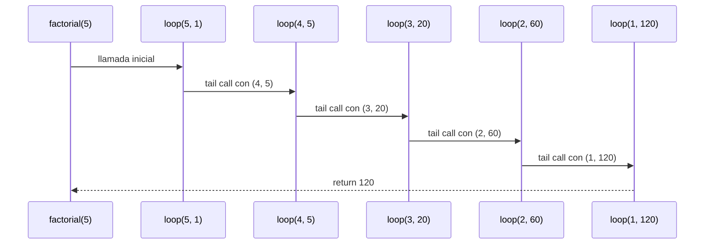
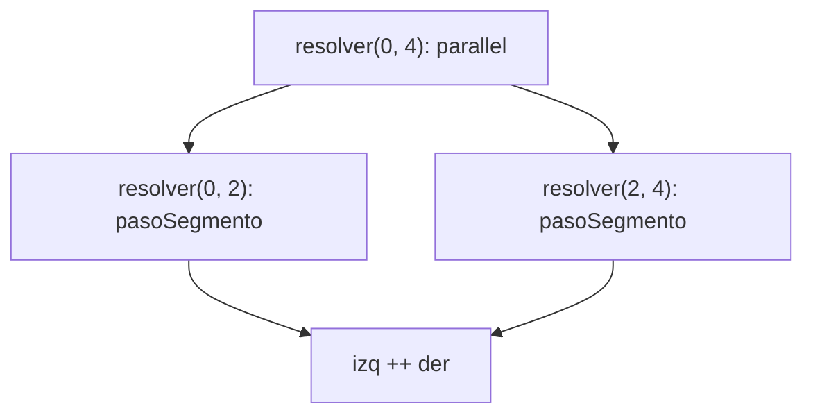
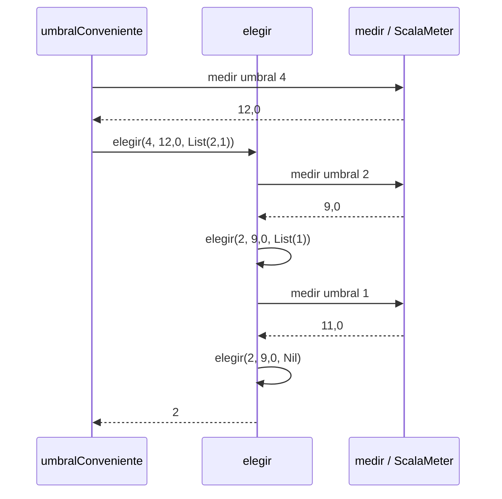

# Algoritmo Factorial con Recursión de Cola

## Definición del Algoritmo

```Scala
def factorial(n: Int): BigInt = {
  @annotation.tailrec
  def loop(x: Int, acumulador: BigInt): BigInt = {
    if (x <= 1) acumulador
    else loop(x - 1, acumulador * x)
  }
  loop(n, 1)
}
```

* La función `factorial` calcula el factorial de un número `n` utilizando **recursión de cola**.
* La función interna `loop` es la que hace la recursión:

  * Recibe dos parámetros:

    * `x`: el valor actual decreciente hasta llegar a 1.
    * `acumulador`: donde se guarda el resultado parcial en cada paso.
* El decorador `@annotation.tailrec` obliga a que la función sea optimizada como recursión de cola, es decir, **no se acumulan llamados en la pila**.

## Explicación paso a paso

### Caso base

```Scala
if (x <= 1) acumulador
```

Cuando `x` llega a `1`, la función retorna directamente el valor acumulado, evitando más llamadas.

### Caso recursivo

```Scala
loop(x - 1, acumulador * x)
```

En cada llamada:

* Se reduce el valor de `x` en 1.
* Se multiplica el acumulador por `x` y se pasa a la siguiente iteración.
* Como es recursión de cola, la llamada recursiva es la **última instrucción** en ejecutarse, lo que permite a Scala optimizar la pila.

---

## Llamados de pila en recursión de cola

Ejemplo:

```Scala
factorial(5)
```

### Paso 1: Llamada inicial

```Scala
loop(5, 1)
```

### Paso 2: Primera iteración

```Scala
loop(4, 5)   // acumulador = 1 * 5
```

### Paso 3: Segunda iteración

```Scala
loop(3, 20)  // acumulador = 5 * 4
```

### Paso 4: Tercera iteración

```Scala
loop(2, 60)  // acumulador = 20 * 3
```

### Paso 5: Cuarta iteración

```Scala
loop(1, 120) // acumulador = 60 * 2
```

### Paso 6: Caso base

```Scala
return 120
```

---

## Diferencia con recursión normal

* En **recursión normal** cada llamada queda en la pila esperando a que termine la siguiente, lo que puede causar desbordamiento si `n` es muy grande.
* En **recursión de cola**, el compilador transforma el proceso en un **bucle optimizado**, por lo que no se guarda cada llamada en la pila y el algoritmo puede ejecutarse para valores muy grandes sin problema.

---

## Ejemplo de uso

```Scala
val resultado = factorial(5)
println(resultado)  // 120
```

El resultado de `factorial(5)` es `120`.


## Diagrama de llamados de pila con recursión de cola



---

## Punto 5: aceleración y elección del umbral

El punto 5 no mueve partículas nuevas: mide cuánto tarda lo que ya hace el
punto 1 y compara los tiempos. Las dos funciones nuevas se siguen con el modelo
de sustitución, igual que `factorial` al comienzo de este informe.

### `aceleracion`

```Scala
def aceleracion(tSecuencial: Double, tParalelo: Double): Double =
  tSecuencial / tParalelo
```

No hay llamados auxiliares: se sustituye directamente.

```Scala
aceleracion(7.5, 2.5) → 7.5 / 2.5 → 3.0
aceleracion(0.2, 0.8) → 0.2 / 0.8 → 0.25
```

El primer caso dice que lo paralelo tardó la tercera parte; el segundo, que
tardó cuatro veces más y por eso la cifra baja de 1.

### Cómo se ejecuta `pasoParalelo`

Antes de medir conviene saber qué se mide. Con cuatro partículas y umbral 2:

```Scala
resolver(0, 4): 4 - 0 > 2  → parallel(resolver(0, 2), resolver(2, 4))
resolver(0, 2): 2 - 0 > 2 es falso → pasoSegmento(s, dt, 0, 2) → [p0', p1']
resolver(2, 4): 2 - 0 > 2 es falso → pasoSegmento(s, dt, 2, 4) → [p2', p3']
izq ++ der → [p0', p1', p2', p3']
```

Cada índice aparece en un solo tramo y el orden se conserva porque `++` pega
primero la izquierda y después la derecha.



Con umbral igual al tamaño no hay ni un `parallel`: `resolver(0, 4)` cae
directo en `pasoSegmento(s, dt, 0, 4)`, que es exactamente lo que hace
`pasoSecuencial`. Esa es la fila de control de la medición.

### Cómo se ejecuta `umbralConveniente`

```Scala
def umbralConveniente(s: Sistema, dt: Double, umbrales: List[Int]): Int = {
  @tailrec
  def elegir(mejor: Int, mejorTiempo: Double, candidatos: List[Int]): Int =
    candidatos match {
      case Nil => mejor
      case u :: resto =>
        val tiempo = medir(3)(pasoParalelo(s, dt, u))
        if (tiempo < mejorTiempo) elegir(u, tiempo, resto)
        else elegir(mejor, mejorTiempo, resto)
    }

  umbrales match {
    case Nil => s.length
    case u :: resto => elegir(u, medir(3)(pasoParalelo(s, dt, u)), resto)
  }
}
```

La lista vacía no se mide: devuelve `s.length`, que es el umbral que impide
repartir. Con candidatos, el primero se mide antes de entrar a `elegir` y este
recorre la cola comparando contra el mejor que lleva hasta ahí. Traza con
`umbrales = List(4, 2, 1)` sobre un sistema de cuatro partículas. Los tiempos
son ilustrativos para seguir la traza, no los del informe de paralelización:

| Paso | Llamado | Medición | Decisión |
|---:|---|---:|---|
| 1 | `umbralConveniente(s, dt, List(4, 2, 1))` | `medir(3)(pasoParalelo(s, dt, 4))` = 12,0 | entra con `(4, 12,0, List(2,1))` |
| 2 | `elegir(4, 12,0, List(2, 1))` | `medir(3)(pasoParalelo(s, dt, 2))` = 9,0 | 9,0 < 12,0 → `(2, 9,0, List(1))` |
| 3 | `elegir(2, 9,0, List(1))` | `medir(3)(pasoParalelo(s, dt, 1))` = 11,0 | 11,0 < 9,0 es falso → `(2, 9,0, Nil)` |
| 4 | `elegir(2, 9,0, Nil)` | — | caso base: devuelve `2` |



La mediana la calcula `medir`, que ya viene en el repositorio; `elegir` solo
compara números. En `App.scala` el mismo recorrido se hace a mayor escala: se
mide cada umbral sobre sistemas de uno, 1,5 y dos millones de partículas y se
imprime una tabla con la aceleración de cada uno.


