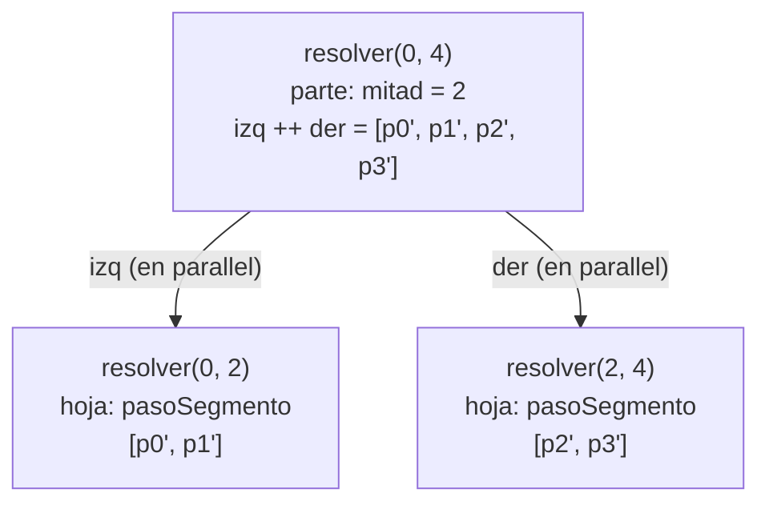
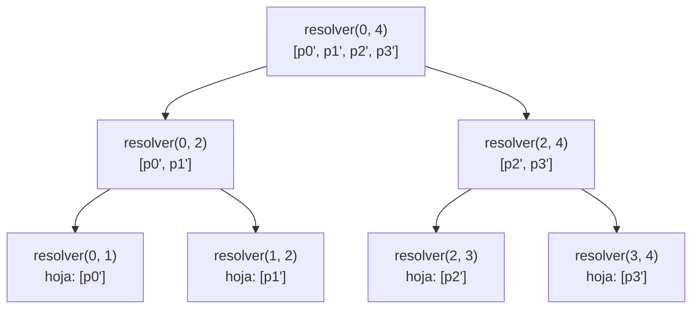
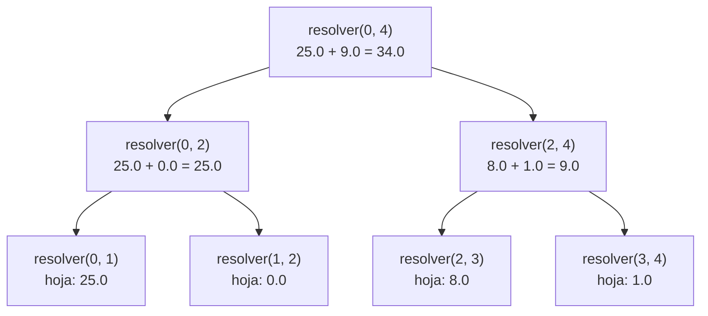
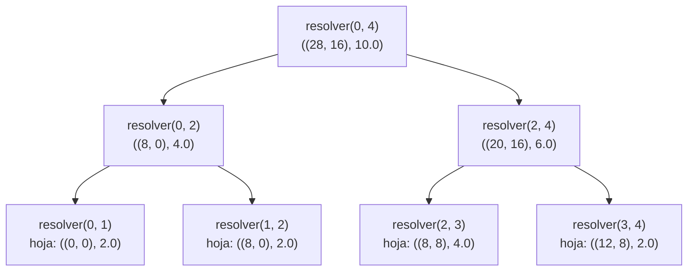
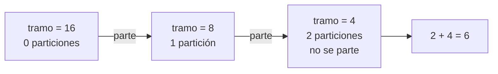
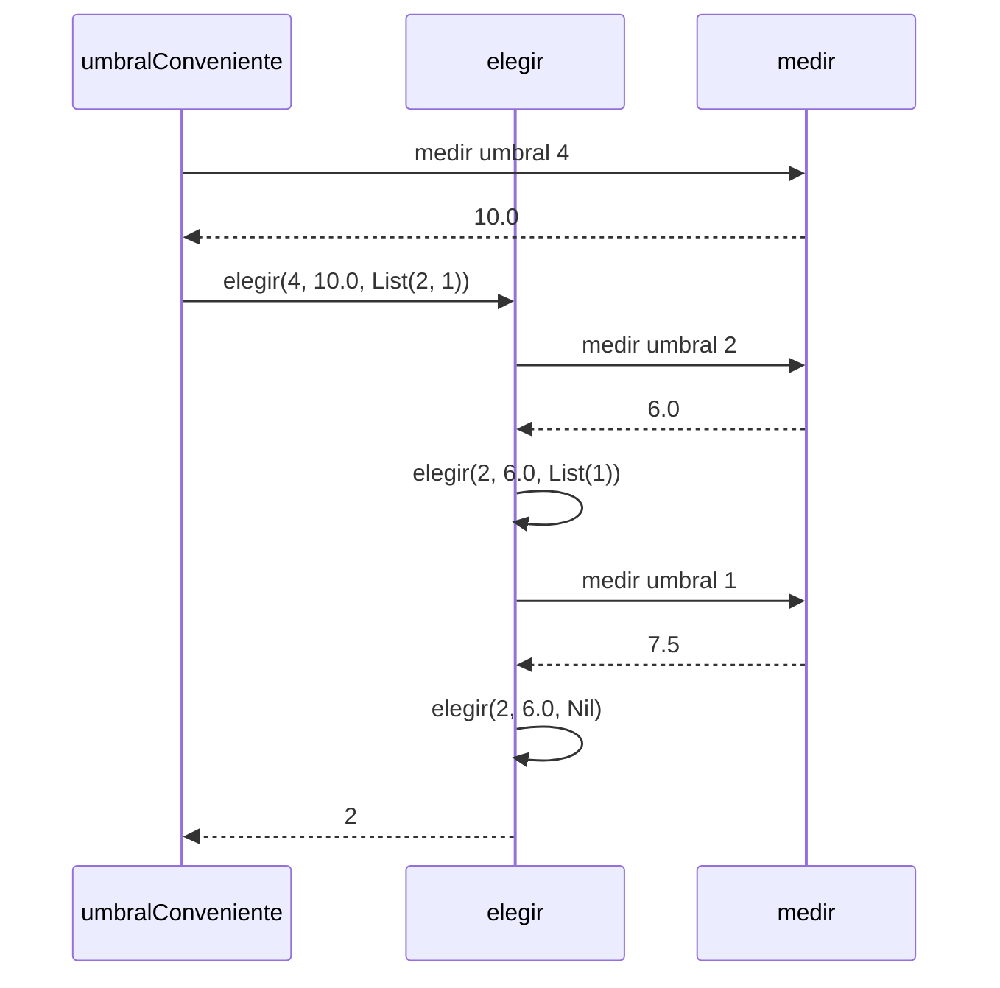

# Informe de proceso

**Taller 4 — Programación funcional y concurrente: simulación de partículas en paralelo**

Este informe explica, paso a paso, cómo se ejecuta cada función de `SimulacionParticulas.scala`. Cada función se sigue con un ejemplo pequeño y con la traza de sus llamados usando el modelo de sustitución. En las funciones repartidas se indica qué tramo resuelve cada llamado y cómo se combinan los resultados parciales.

## 0. Cómo leer este informe

### 0.1 El sistema de ejemplo

Todas las trazas usan el mismo sistema de cuatro partículas:

```Scala
val s = Array(
  Particula(Vector2(0, 0), Vector2(3, 4), 2.0), // p0
  Particula(Vector2(4, 0), Vector2(0, 0), 2.0), // p1
  Particula(Vector2(2, 2), Vector2(0, 2), 4.0), // p2
  Particula(Vector2(6, 4), Vector2(1, 0), 2.0)  // p3
)
```

| Partícula | Posición | Velocidad | Masa | Norma de la velocidad |
|---|---|---|---:|---:|
| `p0` | (0, 0) | (3, 4) | 2.0 | 5.0 |
| `p1` | (4, 0) | (0, 0) | 2.0 | 0.0 |
| `p2` | (2, 2) | (0, 2) | 4.0 | 2.0 |
| `p3` | (6, 4) | (1, 0) | 2.0 | 1.0 |

Para el paso de simulación se usa `dt = 2.0`.

### 0.2 Convenciones de las trazas

- `→` significa "se reemplaza por": es un paso del modelo de sustitución.
- El tramo `[d, h)` contiene los índices `d, d+1, …, h-1`: `d` está incluido y `h` está excluido. Su tamaño es `h - d`.
- `p0'`, `p1'`, … son las partículas ya movidas.
- Para abreviar, los números se escriben sin decimales cuando el valor es entero (por ejemplo `Vector2(3, 4)`), pero en el programa son `Double`.
- `parallel(A, B)` lanza los dos cálculos, que pueden correr a la vez en núcleos distintos, y devuelve la pareja de resultados cuando ambos terminan. En las trazas se escribe `parallel(A, B) → (resultado de A, resultado de B)`.

### 0.3 Funciones del informe

| Punto | Funciones | Sección |
|---|---|---|
| 1 | `mover`, `pasoSegmento`, `pasoSecuencial`, `pasoParalelo` | 1 |
| 2 | `masaTotal`, `energiaSecuencial`, `centroDeMasaSecuencial` | 2 |
| 3 | `energiaParalela`, `centroDeMasaParalelo` | 3 |
| 4 | `trabajo`, `profundidad`, `tiempoEstimado` | 4 |
| 5 | `medir`, `aceleracion`, `umbralConveniente` | 5 |

---

## 1. Punto 1: un paso de la simulación

### 1.1 `mover`

```Scala
def mover(p: Particula, dt: Double): Particula = {
  val nueva_pos = p.pos + p.vel * dt
  new Particula(nueva_pos, p.vel, p.masa)
}
```

`mover` crea una partícula nueva. La posición nueva es la anterior más la velocidad por `dt`; la velocidad y la masa se copian sin cambio:

$$
\text{posición nueva} = r + dt \cdot v
$$

Traza con `p0` y `dt = 2.0`:

```Scala
mover(p0, 2.0)
→ nueva_pos = p0.pos + p0.vel * 2.0
→ Vector2(0, 0) + Vector2(3, 4) * 2.0
→ Vector2(0, 0) + Vector2(6, 8)         // el producto multiplica cada componente por 2.0
→ Vector2(6, 8)                         // la suma es componente a componente
→ new Particula(Vector2(6, 8), Vector2(3, 4), 2.0)
```

Aplicada a todo el sistema con `dt = 2.0`:

| Partícula | Posición antes | Velocidad × dt | Posición después |
|---|---|---|---|
| `p0` → `p0'` | (0, 0) | (6, 8) | (6, 8) |
| `p1` → `p1'` | (4, 0) | (0, 0) | (4, 0) |
| `p2` → `p2'` | (2, 2) | (0, 4) | (2, 6) |
| `p3` → `p3'` | (6, 4) | (2, 0) | (8, 4) |

### 1.2 `pasoSegmento`

```Scala
def pasoSegmento(s: Sistema, dt: Double, desde: Int, hasta: Int): Sistema =
  s.slice(desde, hasta).map(p => mover(p, dt))
```

Se ejecuta en dos pasos: `slice` toma solo el tramo `[desde, hasta)` y `map` aplica `mover` a cada partícula del tramo, en orden.

Traza con el tramo `[1, 3)`:

```Scala
pasoSegmento(s, 2.0, 1, 3)
→ s.slice(1, 3).map(p => mover(p, 2.0))
→ Array(p1, p2).map(p => mover(p, 2.0))
→ Array(mover(p1, 2.0), mover(p2, 2.0))
→ Array(p1', p2')
→ Array(Particula(Vector2(4, 0), …), Particula(Vector2(2, 6), …))
```

Si `desde == hasta`, el tramo es vacío y el resultado es un arreglo vacío.

### 1.3 `pasoSecuencial`

```Scala
def pasoSecuencial(s: Sistema, dt: Double): Sistema =
  pasoSegmento(s, dt, 0, s.length)
```

Es `pasoSegmento` sobre el tramo completo:

```Scala
pasoSecuencial(s, 2.0)
→ pasoSegmento(s, 2.0, 0, 4)
→ s.slice(0, 4).map(p => mover(p, 2.0))
→ Array(p0, p1, p2, p3).map(p => mover(p, 2.0))
→ Array(p0', p1', p2', p3')
```

### 1.4 `pasoParalelo`

```Scala
def pasoParalelo(s: Sistema, dt: Double, umbral: Int): Sistema = {
  def resolver(desde: Int, hasta: Int): Sistema =
    if (hasta - desde > Math.max(umbral, 1)) {
      val mitad = desde + (hasta - desde) / 2
      val (izq, der) = parallel(resolver(desde, mitad), resolver(mitad, hasta))
      izq ++ der
    } else pasoSegmento(s, dt, desde, hasta)

  resolver(0, s.length)
}
```

La función interna `resolver(desde, hasta)` resuelve el tramo `[desde, hasta)` así:

1. Compara el tamaño del tramo, `hasta - desde`, con el umbral. Se usa `Math.max(umbral, 1)` para que un umbral cero o negativo se comporte como un umbral de 1.
2. Si el tramo es **más grande** que el umbral, lo parte por la mitad: `mitad = desde + (hasta - desde) / 2`. Resuelve `[desde, mitad)` y `[mitad, hasta)` con `parallel`, y pega los dos resultados con `izq ++ der`: primero la izquierda y luego la derecha.
3. Si el tramo **no** es más grande que el umbral, lo resuelve en secuencial con `pasoSegmento`. Esta es una **hoja** de la recursión.

#### Traza con umbral 2

```Scala
pasoParalelo(s, 2.0, 2)
→ resolver(0, 4)

resolver(0, 4): 4 - 0 = 4 > Math.max(2, 1) = 2 es verdadero
  mitad = 0 + (4 - 0) / 2 = 2
  → parallel(resolver(0, 2), resolver(2, 4))

resolver(0, 2): 2 - 0 = 2 > 2 es falso
  → pasoSegmento(s, 2.0, 0, 2) → Array(p0', p1')

resolver(2, 4): 4 - 2 = 2 > 2 es falso
  → pasoSegmento(s, 2.0, 2, 4) → Array(p2', p3')

parallel(…) → (Array(p0', p1'), Array(p2', p3'))
izq ++ der  → Array(p0', p1', p2', p3')
```

| Llamado | Tramo | Tamaño | ¿Se parte? | Qué hace | Resultado |
|---|---|---:|---|---|---|
| `resolver(0, 4)` | `[0, 4)` | 4 | Sí (4 > 2) | `parallel` de los dos tramos + `++` | `[p0', p1', p2', p3']` |
| `resolver(0, 2)` | `[0, 2)` | 2 | No (2 > 2 es falso) | `pasoSegmento(s, 2.0, 0, 2)` | `[p0', p1']` |
| `resolver(2, 4)` | `[2, 4)` | 2 | No (2 > 2 es falso) | `pasoSegmento(s, 2.0, 2, 4)` | `[p2', p3']` |



Cada índice, del 0 al 3, queda en exactamente un tramo, y el orden se conserva porque `++` pega primero el resultado de la izquierda y después el de la derecha.

#### Traza con umbral 1

Con umbral 1 los tramos se siguen partiendo hasta quedar de un solo elemento:

```Scala
resolver(0, 4): 4 > 1 → mitad = 2 → parallel(resolver(0, 2), resolver(2, 4))
  resolver(0, 2): 2 > 1 → mitad = 1 → parallel(resolver(0, 1), resolver(1, 2))
    resolver(0, 1): 1 > 1 es falso → pasoSegmento(s, 2.0, 0, 1) → Array(p0')
    resolver(1, 2): 1 > 1 es falso → pasoSegmento(s, 2.0, 1, 2) → Array(p1')
    Array(p0') ++ Array(p1') → Array(p0', p1')
  resolver(2, 4): 2 > 1 → mitad = 3 → parallel(resolver(2, 3), resolver(3, 4))
    resolver(2, 3): 1 > 1 es falso → pasoSegmento(s, 2.0, 2, 3) → Array(p2')
    resolver(3, 4): 1 > 1 es falso → pasoSegmento(s, 2.0, 3, 4) → Array(p3')
    Array(p2') ++ Array(p3') → Array(p2', p3')
  Array(p0', p1') ++ Array(p2', p3') → Array(p0', p1', p2', p3')
```



Las cuatro hojas son los tramos `[0, 1)`, `[1, 2)`, `[2, 3)` y `[3, 4)`: juntos cubren `[0, 4)` sin solaparse. Todas las hojas dan el mismo arreglo final que con umbral 2.

#### Casos que conviene tener presentes

| Caso | Qué ocurre | Resultado |
|---|---|---|
| Umbral igual o mayor que el tamaño (por ejemplo `umbral = 4`) | `resolver(0, 4)`: 4 > 4 es falso, cae directo en `pasoSegmento(s, 2.0, 0, 4)`. No hay ningún `parallel` | `[p0', p1', p2', p3']`, igual que `pasoSecuencial` |
| Umbral 0 o negativo | `Math.max(umbral, 1)` es 1, así que se comporta como el umbral 1 | Igual que la traza con umbral 1 |
| Arreglo vacío | `resolver(0, 0)`: 0 > 1 es falso, y `pasoSegmento(s, dt, 0, 0)` devuelve un arreglo vacío | `[]` |

---

## 2. Punto 2: magnitudes globales en secuencial

Las tres funciones recorren el arreglo con una función auxiliar recursiva de cola, `aux`. En cada llamado `aux` mira la partícula `s(i)`, actualiza el acumulado y pasa a `i + 1`. Cuando `i >= s.length` devuelve lo acumulado. Como la llamada recursiva es lo último que se ejecuta, no se acumulan llamados en la pila.

### 2.1 `masaTotal`

```Scala
def masaTotal(s: Sistema): Double = {
  @annotation.tailrec
  def aux(i: Int, acc: Double): Double =
    if (i >= s.length) acc
    else aux(i + 1, acc + s(i).masa)

  aux(0, 0.0)
}
```

```Scala
masaTotal(s) → aux(0, 0.0)

aux(0, 0.0)  : 0 >= 4 es falso → aux(1, 0.0 + s(0).masa) → aux(1, 2.0)
aux(1, 2.0)  : 1 >= 4 es falso → aux(2, 2.0 + 2.0)       → aux(2, 4.0)
aux(2, 4.0)  : 2 >= 4 es falso → aux(3, 4.0 + 4.0)       → aux(3, 8.0)
aux(3, 8.0)  : 3 >= 4 es falso → aux(4, 8.0 + 2.0)       → aux(4, 10.0)
aux(4, 10.0) : 4 >= 4 es verdadero → 10.0
```

### 2.2 `energiaSecuencial`

```Scala
def energiaSecuencial(s: Sistema): Double = {
  def energiaDe(p: Particula): Double = (0.5 * p.masa) * (p.vel.norma * p.vel.norma)
  @annotation.tailrec
  def aux(i: Int, acc: Double): Double =
    if (i >= s.length) acc
    else aux(i + 1, acc + energiaDe(s(i)))

  aux(0, 0.0)
}
```

`energiaDe` calcula la energía cinética de una partícula, $`\tfrac{1}{2} m \lVert v \rVert^2`$. Para cada partícula del ejemplo:

| Partícula | `0.5 * masa` | `norma * norma` | `energiaDe` |
|---|---:|---:|---:|
| `p0` | 1.0 | 5.0 · 5.0 = 25.0 | 25.0 |
| `p1` | 1.0 | 0.0 · 0.0 = 0.0 | 0.0 |
| `p2` | 2.0 | 2.0 · 2.0 = 4.0 | 8.0 |
| `p3` | 1.0 | 1.0 · 1.0 = 1.0 | 1.0 |

```Scala
energiaSecuencial(s) → aux(0, 0.0)

aux(0, 0.0)  : → aux(1, 0.0 + energiaDe(p0)) → aux(1, 25.0)
aux(1, 25.0) : → aux(2, 25.0 + energiaDe(p1)) → aux(2, 25.0)
aux(2, 25.0) : → aux(3, 25.0 + energiaDe(p2)) → aux(3, 33.0)
aux(3, 33.0) : → aux(4, 33.0 + energiaDe(p3)) → aux(4, 34.0)
aux(4, 34.0) : 4 >= 4 es verdadero → 34.0
```

Con el arreglo vacío, `aux(0, 0.0)` ya cumple `0 >= 0` y devuelve `0.0`.

### 2.3 `centroDeMasaSecuencial`

```Scala
def centroDeMasaSecuencial(s: Sistema): Vector2 = {
  @annotation.tailrec
  def aux(i: Int, suma: Vector2, masa: Double): (Vector2, Double) =
    if (i >= s.length) (suma, masa)
    else {
      val p = s(i)
      aux(i + 1, suma + p.pos * p.masa, masa + p.masa)
    }

  val (suma, masa) = aux(0, Vector2(0, 0), 0.0)
  if (masa == 0.0) Vector2(0, 0) else suma * (1.0 / masa)
}
```

Esta función hace dos cosas: `aux` acumula **a la vez** la suma de las posiciones ponderadas por la masa y la masa total, y después se divide **una sola vez**:

$$
C = \frac{\sum_i m_i \, r_i}{\sum_i m_i}
$$

```Scala
centroDeMasaSecuencial(s)
→ val (suma, masa) = aux(0, Vector2(0, 0), 0.0)

aux(0, Vector2(0, 0), 0.0)  : → aux(1, (0, 0) + (0, 0) * 2.0, 0.0 + 2.0)   → aux(1, Vector2(0, 0), 2.0)
aux(1, Vector2(0, 0), 2.0)  : → aux(2, (0, 0) + (4, 0) * 2.0, 2.0 + 2.0)   → aux(2, Vector2(8, 0), 4.0)
aux(2, Vector2(8, 0), 4.0)  : → aux(3, (8, 0) + (2, 2) * 4.0, 4.0 + 4.0)   → aux(3, Vector2(16, 8), 8.0)
aux(3, Vector2(16, 8), 8.0) : → aux(4, (16, 8) + (6, 4) * 2.0, 8.0 + 2.0)  → aux(4, Vector2(28, 16), 10.0)
aux(4, Vector2(28, 16), 10.0): 4 >= 4 es verdadero → (Vector2(28, 16), 10.0)

→ suma = Vector2(28, 16), masa = 10.0
→ masa == 0.0 es falso → suma * (1.0 / 10.0) → Vector2(2.8, 1.6)
```

El centro de masa del ejemplo es $`(2.8, \; 1.6)`$. (En `Double` puede aparecer un residuo de redondeo del orden de $`10^{-16}`$, por ejemplo `2.8000000000000003`.)

Si la masa total es cero, por ejemplo con un arreglo vacío, `aux` devuelve `(Vector2(0, 0), 0.0)`, la condición `masa == 0.0` es verdadera y la función devuelve el origen `Vector2(0, 0)` sin dividir.

---

## 3. Punto 3: las mismas magnitudes en paralelo

Las versiones paralelas usan la misma regla de reparto de `pasoParalelo`: un tramo `[desde, hasta)` más grande que `Math.max(umbral, 1)` se parte en `mitad = desde + (hasta - desde) / 2` y se resuelve con `parallel`. Lo que cambia es **qué devuelve cada tramo** y **con qué operación se combinan** los resultados:

| Función | Cada hoja devuelve | Los dos resultados se combinan con |
|---|---|---|
| `pasoParalelo` | El arreglo de las partículas movidas del tramo | `izq ++ der` (concatenar) |
| `energiaParalela` | La suma de las energías del tramo | `izq + der` (suma de números) |
| `centroDeMasaParalelo` | La pareja (suma ponderada, masa) del tramo | Suma de cada componente de la pareja |

### 3.1 `energiaParalela`

```Scala
def energiaParalela(s: Sistema, umbral: Int): Double = {
  def energiaDe(p: Particula): Double = (0.5 * p.masa) * (p.vel.norma * p.vel.norma)

  @tailrec
  def sumaTramo(i: Int, hasta: Int, acc: Double): Double =
    if (i >= hasta) acc
    else sumaTramo(i + 1, hasta, acc + energiaDe(s(i)))

  def resolver(desde: Int, hasta: Int): Double =
    if (hasta - desde > Math.max(umbral, 1)) {
      val mitad = desde + (hasta - desde) / 2
      val (izq, der) = parallel(resolver(desde, mitad), resolver(mitad, hasta))
      izq + der
    } else sumaTramo(desde, hasta, 0.0)

  resolver(0, s.length)
}
```

Hay dos funciones internas:

- `sumaTramo(i, hasta, acc)` suma, de forma secuencial y recursiva de cola, las energías de las partículas `i, …, hasta - 1` sobre un acumulado `acc`.
- `resolver(desde, hasta)` reparte: si el tramo es grande, lo parte y suma los dos resultados parciales; si no, lo resuelve con `sumaTramo` empezando con acumulado `0.0`.

#### Traza con umbral 1

```Scala
energiaParalela(s, 1) → resolver(0, 4)

resolver(0, 4): 4 > 1 → mitad = 2 → parallel(resolver(0, 2), resolver(2, 4))
  resolver(0, 2): 2 > 1 → mitad = 1 → parallel(resolver(0, 1), resolver(1, 2))
    resolver(0, 1): 1 > 1 es falso → sumaTramo(0, 1, 0.0)
                    → sumaTramo(1, 1, 0.0 + 25.0) → 25.0        // 1 >= 1, devuelve acc
    resolver(1, 2): 1 > 1 es falso → sumaTramo(1, 2, 0.0)
                    → sumaTramo(2, 2, 0.0 + 0.0) → 0.0
    parallel(…) → (25.0, 0.0)  →  izq + der = 25.0 + 0.0 = 25.0
  resolver(2, 4): 2 > 1 → mitad = 3 → parallel(resolver(2, 3), resolver(3, 4))
    resolver(2, 3): → sumaTramo(2, 3, 0.0) → sumaTramo(3, 3, 8.0) → 8.0
    resolver(3, 4): → sumaTramo(3, 4, 0.0) → sumaTramo(4, 4, 1.0) → 1.0
    parallel(…) → (8.0, 1.0)  →  izq + der = 8.0 + 1.0 = 9.0
  parallel(…) → (25.0, 9.0)  →  izq + der = 25.0 + 9.0 = 34.0
```

| Llamado | Tramo | ¿Se parte? | Qué devuelve |
|---|---|---|---|
| `resolver(0, 4)` | `[0, 4)` | Sí | `25.0 + 9.0 = 34.0` |
| `resolver(0, 2)` | `[0, 2)` | Sí | `25.0 + 0.0 = 25.0` |
| `resolver(2, 4)` | `[2, 4)` | Sí | `8.0 + 1.0 = 9.0` |
| `resolver(0, 1)` | `[0, 1)` | No: `sumaTramo` | `25.0` (energía de `p0`) |
| `resolver(1, 2)` | `[1, 2)` | No: `sumaTramo` | `0.0` (energía de `p1`) |
| `resolver(2, 3)` | `[2, 3)` | No: `sumaTramo` | `8.0` (energía de `p2`) |
| `resolver(3, 4)` | `[3, 4)` | No: `sumaTramo` | `1.0` (energía de `p3`) |



El resultado, `34.0`, es el mismo que devuelve `energiaSecuencial(s)`.

#### Traza con umbral 2

```Scala
energiaParalela(s, 2) → resolver(0, 4)

resolver(0, 4): 4 > 2 → mitad = 2 → parallel(resolver(0, 2), resolver(2, 4))
  resolver(0, 2): 2 > 2 es falso → sumaTramo(0, 2, 0.0)
                  → sumaTramo(1, 2, 25.0) → sumaTramo(2, 2, 25.0) → 25.0
  resolver(2, 4): 2 > 2 es falso → sumaTramo(2, 4, 0.0)
                  → sumaTramo(3, 4, 8.0) → sumaTramo(4, 4, 9.0) → 9.0
parallel(…) → (25.0, 9.0)  →  izq + der = 34.0
```

Con un umbral mayor hay menos hojas y cada hoja suma más partículas, pero el total es el mismo.

### 3.2 `centroDeMasaParalelo`

```Scala
def centroDeMasaParalelo(s: Sistema, umbral: Int): Vector2 = {
  @tailrec
  def sumaTramo(i: Int, hasta: Int, suma: Vector2, masa: Double): (Vector2, Double) =
    if (i >= hasta) (suma, masa)
    else {
      val p = s(i)
      sumaTramo(i + 1, hasta, suma + p.pos * p.masa, masa + p.masa)
    }

  def resolver(desde: Int, hasta: Int): (Vector2, Double) =
    if (hasta - desde > Math.max(umbral, 1)) {
      val mitad = desde + (hasta - desde) / 2
      val (izq, der) = parallel(resolver(desde, mitad), resolver(mitad, hasta))
      (izq._1 + der._1, izq._2 + der._2)
    } else sumaTramo(desde, hasta, Vector2(0, 0), 0.0)

  val (suma, masa) = resolver(0, s.length)
  if (masa == 0.0) Vector2(0, 0) else suma * (1.0 / masa)
}
```

Aquí cada tramo devuelve una **pareja**: `(suma de posición * masa, masa del tramo)`. Para combinar dos tramos se suman las dos componentes por separado: `izq._1 + der._1` (las sumas ponderadas) y `izq._2 + der._2` (las masas). La división ocurre **una sola vez**, al final, sobre el total.

#### Traza con umbral 1

```Scala
centroDeMasaParalelo(s, 1) → resolver(0, 4)

resolver(0, 4): 4 > 1 → mitad = 2 → parallel(resolver(0, 2), resolver(2, 4))
  resolver(0, 2): 2 > 1 → mitad = 1 → parallel(resolver(0, 1), resolver(1, 2))
    resolver(0, 1): → sumaTramo(0, 1, Vector2(0, 0), 0.0)
                    → sumaTramo(1, 1, (0, 0) + (0, 0) * 2.0, 0.0 + 2.0) → (Vector2(0, 0), 2.0)
    resolver(1, 2): → sumaTramo(1, 2, Vector2(0, 0), 0.0)
                    → sumaTramo(2, 2, (0, 0) + (4, 0) * 2.0, 0.0 + 2.0) → (Vector2(8, 0), 2.0)
    parallel(…) → ((Vector2(0, 0), 2.0), (Vector2(8, 0), 2.0))
    combinar → (Vector2(0, 0) + Vector2(8, 0), 2.0 + 2.0) = (Vector2(8, 0), 4.0)
  resolver(2, 4): 2 > 1 → mitad = 3 → parallel(resolver(2, 3), resolver(3, 4))
    resolver(2, 3): → sumaTramo(2, 3, Vector2(0, 0), 0.0)
                    → sumaTramo(3, 3, (0, 0) + (2, 2) * 4.0, 0.0 + 4.0) → (Vector2(8, 8), 4.0)
    resolver(3, 4): → sumaTramo(3, 4, Vector2(0, 0), 0.0)
                    → sumaTramo(4, 4, (0, 0) + (6, 4) * 2.0, 0.0 + 2.0) → (Vector2(12, 8), 2.0)
    parallel(…) → ((Vector2(8, 8), 4.0), (Vector2(12, 8), 2.0))
    combinar → (Vector2(8, 8) + Vector2(12, 8), 4.0 + 2.0) = (Vector2(20, 16), 6.0)
  parallel(…) → ((Vector2(8, 0), 4.0), (Vector2(20, 16), 6.0))
  combinar → (Vector2(8, 0) + Vector2(20, 16), 4.0 + 6.0) = (Vector2(28, 16), 10.0)

→ val (suma, masa) = (Vector2(28, 16), 10.0)
→ masa == 0.0 es falso → suma * (1.0 / 10.0) → Vector2(2.8, 1.6)
```

| Llamado | Tramo | Qué devuelve (suma ponderada, masa) |
|---|---|---|
| `resolver(0, 4)` | `[0, 4)` | `((28, 16), 10.0)` |
| `resolver(0, 2)` | `[0, 2)` | `((8, 0), 4.0)` |
| `resolver(2, 4)` | `[2, 4)` | `((20, 16), 6.0)` |
| `resolver(0, 1)` | `[0, 1)` | `((0, 0), 2.0)` |
| `resolver(1, 2)` | `[1, 2)` | `((8, 0), 2.0)` |
| `resolver(2, 3)` | `[2, 3)` | `((8, 8), 4.0)` |
| `resolver(3, 4)` | `[3, 4)` | `((12, 8), 2.0)` |



El resultado, $`(2.8, \; 1.6)`$, es el mismo que devuelve `centroDeMasaSecuencial(s)`.

#### Por qué se lleva la pareja y no el promedio de cada mitad

Con el mismo ejemplo, las dos mitades `[0, 2)` y `[2, 4)` tienen masas distintas, `4.0` y `6.0`. Si cada mitad devolviera su propio centro de masa y se promediaran:

| Tramo | Suma ponderada | Masa | Centro de masa del tramo |
|---|---|---:|---|
| `[0, 2)` | (8, 0) | 4.0 | (8/4, 0/4) = (2, 0) |
| `[2, 4)` | (20, 16) | 6.0 | (20/6, 16/6) ≈ (3.333, 2.667) |
| Promedio de los dos centros | | | ((2 + 3.333)/2, (0 + 2.667)/2) ≈ (2.667, 1.333) |
| Resultado correcto (el que da el código) | (28, 16) | 10.0 | (28/10, 16/10) = (2.8, 1.6) |

Los dos valores no coinciden, porque la mitad de la derecha pesa más. Por eso cada hoja devuelve la suma ponderada y la masa por separado: se suman las dos componentes, y solo cuando ya se tiene el total de todo el sistema se divide, una vez. Este análisis se argumenta con más detalle en el informe de corrección.

Si la masa total es cero, `resolver` devuelve `(Vector2(0, 0), 0.0)` en el tramo completo, la condición `masa == 0.0` es verdadera y la función devuelve el origen, igual que la versión secuencial.

---

## 4. Punto 4: trabajo y profundidad

Estas tres funciones no recorren el arreglo: estiman el costo con números. Para los ejemplos se usa un sistema de $`n = 16`$ partículas y $`p = 4`$ procesadores.

### 4.1 `trabajo`

```Scala
def trabajo(n: Int): Int = n
```

El trabajo es el número total de operaciones, una por partícula. No cambia por repartir el cálculo:

```Scala
trabajo(16) → 16
```

### 4.2 `profundidad`

```Scala
def profundidad(n: Int, umbral: Int): Int = {
  @tailrec
  def aux(tramo: Int, particiones: Int): Int =
    if (tramo <= Math.max(umbral, 1)) particiones + tramo
    else aux(tramo - tramo / 2, particiones + 1)

  aux(n, 0)
}
```

`aux(tramo, particiones)` lleva el tamaño del tramo que se está mirando y cuántas veces se ha partido. En cada llamado:

1. Si el tramo ya cabe en el umbral (`tramo <= Math.max(umbral, 1)`), termina y devuelve las particiones hechas más el tamaño del tramo que queda sin partir.
2. Si no, parte el tramo: `tramo - tramo / 2` es el tamaño de la mitad **mayor** (si el tramo es impar, la mitad mayor tiene un elemento más), y cuenta una partición más.

Traza con `n = 16` y umbral 4:

```Scala
profundidad(16, 4) → aux(16, 0)

aux(16, 0) : 16 <= Math.max(4, 1) = 4 es falso → aux(16 - 16/2, 0 + 1) → aux(8, 1)
aux(8, 1)  : 8 <= 4 es falso                  → aux(8 - 8/2, 1 + 1)   → aux(4, 2)
aux(4, 2)  : 4 <= 4 es verdadero → 2 + 4 → 6
```



Con un tramo impar, `tramo - tramo / 2` se queda con la mitad mayor. Traza con `n = 10` y umbral 3:

```Scala
profundidad(10, 3) → aux(10, 0)

aux(10, 0) : 10 <= 3 es falso → aux(10 - 10/2, 1) → aux(5, 1)    // las dos mitades miden 5
aux(5, 1)  : 5 <= 3 es falso  → aux(5 - 5/2, 2)   → aux(3, 2)    // las mitades miden 2 y 3: se sigue la de 3
aux(3, 2)  : 3 <= 3 es verdadero → 2 + 3 → 5
```

Otros valores para `n = 16`:

| Umbral | Cadena de tramos | Particiones | Tramo sin partir | `profundidad(16, umbral)` |
|---:|---|---:|---:|---:|
| 16 | 16 | 0 | 16 | 16 |
| 4 | 16 → 8 → 4 | 2 | 4 | 6 |
| 1 | 16 → 8 → 4 → 2 → 1 | 4 | 1 | 5 |

### 4.3 `tiempoEstimado`

```Scala
def tiempoEstimado(n: Int, p: Int, umbral: Int): Double =
  profundidad(n, umbral) + trabajo(n).toDouble / p
```

Suma la profundidad y el trabajo repartido entre `p` procesadores. Primero se evalúa `trabajo(n).toDouble / p`, con división de `Double` (así no se trunca), y luego se suma la profundidad.

```Scala
tiempoEstimado(16, 4, 4)
→ profundidad(16, 4) + trabajo(16).toDouble / 4
→ 6 + 16.toDouble / 4
→ 6 + 16.0 / 4
→ 6 + 4.0
→ 10.0
```

Para `n = 16` y `p = 4` con distintos umbrales:

| Umbral | `profundidad` | `trabajo / p` | `tiempoEstimado` |
|---:|---:|---:|---:|
| 16 | 16 | 4.0 | 20.0 |
| 4 | 6 | 4.0 | 10.0 |
| 1 | 5 | 4.0 | 9.0 |

---

## 5. Punto 5: medir la aceleración

### 5.1 `medir`

```Scala
def medir[A](repeticiones: Int)(cuerpo: => A): Double = {
  val muestras = Vector.fill(repeticiones) {
    (withWarmer(new Warmer.Default) measure { cuerpo }).value
  }
  muestras.sorted.apply(muestras.length / 2)
}
```

`medir` se ejecuta en cuatro pasos:

1. `Vector.fill(repeticiones) { … }` evalúa el bloque `repeticiones` veces. En cada una, ScalaMeter calienta la máquina virtual con `withWarmer(new Warmer.Default)`, ejecuta `cuerpo`, lo mide y `.value` extrae el tiempo en milisegundos. `cuerpo` se recibe por nombre (`=> A`), así que se ejecuta de nuevo en cada medición.
2. El resultado es un `Vector` con una muestra por repetición.
3. `sorted` ordena las muestras de menor a mayor.
4. `apply(muestras.length / 2)` toma el elemento del medio: la mediana.

Traza con `repeticiones = 3`. Los tiempos son ilustrativos, porque los reales dependen de la máquina:

```Scala
medir(3)(pasoParalelo(s, dt, 2))
→ muestras = Vector(4.1, 3.9, 4.0)        // tres mediciones
→ muestras.sorted = Vector(3.9, 4.0, 4.1)
→ muestras.length / 2 = 3 / 2 = 1
→ Vector(3.9, 4.0, 4.1).apply(1) → 4.0
```

La mediana descarta tanto la medición más lenta como la más rápida, así que un único valor atípico no cambia el resultado.

### 5.2 `aceleracion`

```Scala
def aceleracion(tSecuencial: Double, tParalelo: Double): Double =
  tSecuencial / tParalelo
```

No hay llamados auxiliares: se sustituye directamente.

```Scala
aceleracion(100.0, 25.0) → 100.0 / 25.0 → 4.0
aceleracion(30.0, 60.0)  → 30.0 / 60.0  → 0.5
aceleracion(80.0, 80.0)  → 80.0 / 80.0  → 1.0
```

| Llamado | Lectura |
|---|---|
| `aceleracion(100.0, 25.0)` = 4.0 | La versión paralela tardó la cuarta parte |
| `aceleracion(30.0, 60.0)` = 0.5 | La versión paralela tardó el doble: la cifra baja de 1 |
| `aceleracion(80.0, 80.0)` = 1.0 | Los dos tiempos son iguales |

### 5.3 `umbralConveniente`

```Scala
def umbralConveniente(s: Sistema, dt: Double, umbrales: List[Int]): Int = {
  @tailrec
  def elegir(mejor: Int, mejorTiempo: Double, candidatos: List[Int]): Int =
    candidatos match {
      case Nil => mejor
      case u :: resto =>
        val tiempo = medir(3)(pasoParalelo(s, dt, u))
        if (tiempo < mejorTiempo) elegir(u, tiempo, resto)
        else elegir(mejor, mejorTiempo, resto)
    }

  umbrales match {
    case Nil => s.length
    case u :: resto => elegir(u, medir(3)(pasoParalelo(s, dt, u)), resto)
  }
}
```

Se ejecuta así:

1. Si la lista de umbrales es vacía, no se mide nada y devuelve `s.length`, el umbral que impide repartir.
2. Si no, mide el primer candidato con `medir(3)(pasoParalelo(s, dt, u))` y llama a `elegir` con ese umbral como el mejor hasta ahora, su tiempo y el resto de la lista.
3. `elegir` mira el primer candidato de la lista que le queda: lo mide y lo compara con el mejor. Solo lo reemplaza si su tiempo es **estrictamente menor**; si hay empate, se queda con el anterior.
4. Cuando la lista de candidatos se acaba (`Nil`), devuelve el mejor.

Traza con `umbrales = List(4, 2, 1)` sobre el sistema de cuatro partículas. Los tiempos son ilustrativos para seguir la traza:

| Paso | Llamado | Medición | Decisión |
|---:|---|---:|---|
| 1 | `umbralConveniente(s, dt, List(4, 2, 1))` | `medir(3)(pasoParalelo(s, dt, 4))` = 10.0 | Llama a `elegir(4, 10.0, List(2, 1))` |
| 2 | `elegir(4, 10.0, List(2, 1))` | `medir(3)(pasoParalelo(s, dt, 2))` = 6.0 | 6.0 < 10.0 es verdadero → `elegir(2, 6.0, List(1))` |
| 3 | `elegir(2, 6.0, List(1))` | `medir(3)(pasoParalelo(s, dt, 1))` = 7.5 | 7.5 < 6.0 es falso → `elegir(2, 6.0, Nil)` |
| 4 | `elegir(2, 6.0, Nil)` | — | Caso base: devuelve `2` |



Con la lista vacía:

```Scala
umbralConveniente(s, 2.0, List())
→ umbrales match { case Nil => s.length }
→ 4
```

Con `umbral = 4 = s.length`, `pasoParalelo(s, 2.0, 4)` llama a `resolver(0, 4)`, donde 4 > 4 es falso, y por lo tanto resuelve directamente `pasoSegmento(s, 2.0, 0, 4)`, que es lo mismo que hace `pasoSecuencial`: no se reparte nada.

---

## 6. Resumen

| Función | Qué recorre | Cómo se reparte | Cómo se combina |
|---|---|---|---|
| `mover` | Una partícula | No se reparte | — |
| `pasoSegmento` | El tramo `[desde, hasta)` | No se reparte | — |
| `pasoSecuencial` | Todo el arreglo | No se reparte | — |
| `pasoParalelo` | Todo el arreglo | Se parte por la mitad mientras el tramo sea mayor que el umbral | `izq ++ der` |
| `masaTotal` | Todo el arreglo | No se reparte | — |
| `energiaSecuencial` | Todo el arreglo | No se reparte | — |
| `centroDeMasaSecuencial` | Todo el arreglo | No se reparte | Una sola división al final |
| `energiaParalela` | Todo el arreglo | Igual que `pasoParalelo` | `izq + der` |
| `centroDeMasaParalelo` | Todo el arreglo | Igual que `pasoParalelo` | Suma de la pareja (suma ponderada, masa) y una sola división al final |
| `trabajo`, `profundidad`, `tiempoEstimado` | Ninguno: solo calculan con números | — | — |
| `medir` | Repite la medición `repeticiones` veces | — | Ordena y toma la mediana |
| `aceleracion` | Ninguno | — | Cociente de los dos tiempos |
| `umbralConveniente` | La lista de umbrales candidatos | — | Se queda con el de menor tiempo |
